<div align="center">



<a href="#sobre"><kbd>&nbsp;> KEYNAN_&nbsp;</kbd></a>&nbsp;&nbsp;
<a href="#tecnologias"><kbd>&nbsp;[ TECH ]&nbsp;</kbd></a>
<a href="#projetos"><kbd>&nbsp;[ PROJETOS ]&nbsp;</kbd></a>
<a href="#metodo"><kbd>&nbsp;[ MÉTODO ]&nbsp;</kbd></a>
<a href="#contato"><kbd>&nbsp;// FALAR COMIGO&nbsp;</kbd></a>

<br/><br/>


<br/>

<a href="https://github.com/estudantekeynan-lgtm"></a>
<a href="mailto:estudantekeynan@gmail.com"></a>
<a href="https://www.linkedin.com/in/keynan-fellipe-dos-santos-82b6ba405"></a>


</div>

<br/>

<div align="center">

 sistema iniciado [ OK ] — usuário: keynan_fellipe — status: aprendendo, evoluindo, programando" width="800" />

</div>

<br/>

<div align="center">

<sub><code>// QUEM SOU</code></sub>

## SOBRE


</div>

Olá, eu sou o Keynan.

Sou estudante de **Desenvolvimento de Sistemas no SENAI Luiz Varga** e aluno do **SESI CE 005**. Estou construindo minha base em tecnologia por meio de estudos, projetos práticos e desafios de programação.

Tenho interesse em **desenvolvimento web, back-end, lógica de programação e bancos de dados**. Gosto de entender o problema, organizar a solução e transformar cada aprendizado em código mais claro e funcional.

<br/>

<div align="center">
<table>
  <tr>
    <td align="center" width="260">
      <h2>🎯</h2>
      <b><code>FOCO ATUAL</code></b><br/><br/>
      <sub>Desenvolvimento web<br/>e back-end</sub>
    </td>
    <td align="center" width="260">
      <h2>🎓</h2>
      <b><code>FORMAÇÃO</code></b><br/><br/>
      <sub>SENAI Luiz Varga<br/>SESI CE 005</sub>
    </td>
    <td align="center" width="260">
      <h2>📍</h2>
      <b><code>LOCALIZAÇÃO</code></b><br/><br/>
      <sub>Brasil<br/>Disponível para aprender</sub>
    </td>
  </tr>
</table>
</div>

<br/><br/>

<div align="center">

<sub><code>// STACK DE ESTUDO</code></sub>

## TECNOLOGIAS


<br/>


<br/><br/>


<br/>


</div>

<br/><br/>

<div align="center">

<sub><code>// O QUE JÁ CONSTRUÍ</code></sub>

## PROJETOS


</div>

<table>
  <tr>
    <td width="50%" valign="top">
      <sub><code>[ 01 ]</code></sub>
      <h3>▶ LÓGICA DE PROGRAMAÇÃO 2</h3>
      <p>Atividades acadêmicas envolvendo programação, desenvolvimento web, banco de dados e back-end.</p>
      <p><b>Stack:</b> <code>JavaScript</code> <code>Node.js</code> <code>HTML</code> <code>CSS</code> <code>Python</code> <code>SQL</code></p>
    </td>
    <td width="50%" valign="top">
      <sub><code>[ 02 ]</code></sub>
      <h3>▶ PROJETO DISCORD</h3>
      <p>Projeto prático desenvolvido durante minha jornada de estudos e evolução em programação.</p>
      <p><b>Objetivo:</b> transformar conhecimento em uma aplicação funcional.</p>
    </td>
  </tr>
</table>

<br/><br/>

<div align="center">

<sub><code>// COMO EU APRENDO</code></sub>

## MÉTODO


<br/>

<table>
  <tr>
    <td align="center" width="150"><h2><code>01</code></h2><b>ENTENDER</b><br/><sub>o problema</sub></td>
    <td align="center" width="150"><h2><code>02</code></h2><b>DIVIDIR</b><br/><sub>a solução</sub></td>
    <td align="center" width="150"><h2><code>03</code></h2><b>ESTUDAR</b><br/><sub>os conceitos</sub></td>
    <td align="center" width="150"><h2><code>04</code></h2><b>TESTAR</b><br/><sub>o resultado</sub></td>
    <td align="center" width="150"><h2><code>05</code></h2><b>MELHORAR</b><br/><sub>a próxima versão</sub></td>
  </tr>
</table>

</div>

<br/>

<div align="center">



</div>

<br/><br/>

<div align="center">

<sub><code>// TELEMETRIA</code></sub>

## GITHUB EM NÚMEROS


<br/>


<br/><br/>

<sub><code>// CONTRIBUIÇÕES NO ÚLTIMO ANO</code></sub>


</div>

<br/><br/>

<div align="center">

<sub><code>// ROADMAP</code></sub>

## PRÓXIMOS PASSOS


</div>

```diff
+ [ ] Evoluir em desenvolvimento web e back-end.
+ [ ] Aprofundar conhecimentos em bancos de dados.
+ [ ] Transformar exercícios acadêmicos em projetos completos.
+ [ ] Melhorar a qualidade, a organização e a documentação dos códigos.
+ [ ] Construir soluções que demonstrem minha evolução técnica.
```

<br/><br/>

<div align="center">

<sub><code>// CANAL ABERTO</code></sub>

## CONTATO


### Vamos conversar

<a href="mailto:estudantekeynan@gmail.com"></a>
<a href="https://www.linkedin.com/in/keynan-fellipe-dos-santos-82b6ba405"></a>

<br/><br/>




<sub><code>© 2026 keynan_fellipe — desenvolvido com café e código</code></sub>

</div>
